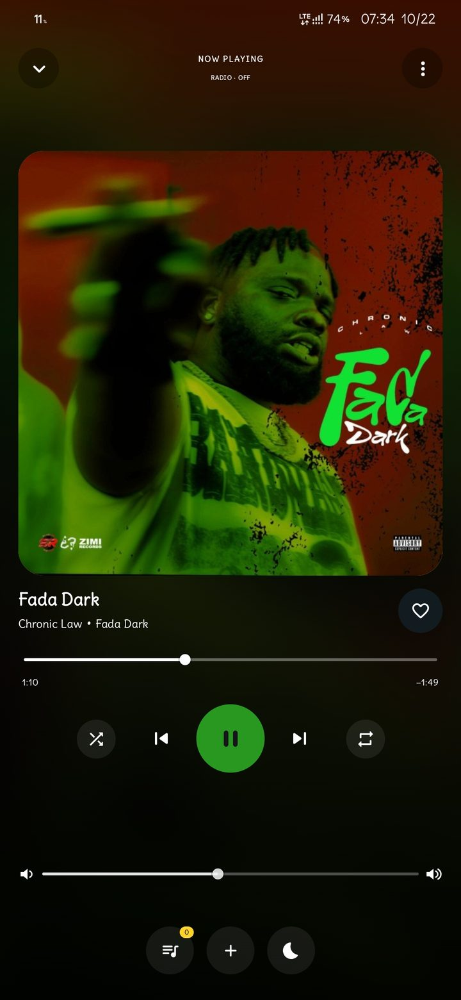
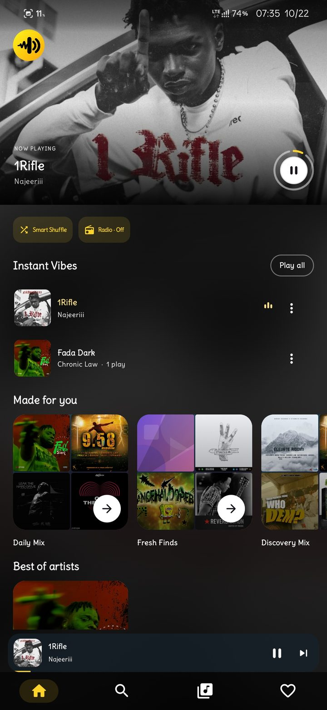
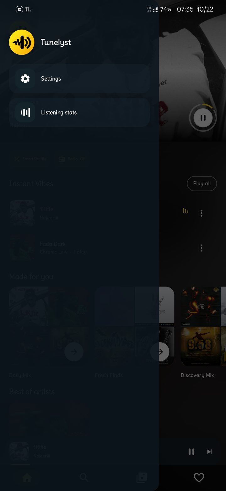

# Tunelyst

**A private music player for Android.** Listen to music saved on your phone, find mixes shaped by your listening, and keep your library close.

 

[**Download Tunelyst**](https://github.com/nyekeza/tunelyst/releases/latest) · [**Visit the website**](https://nyekeza.github.io/tunelyst/)

## See Tunelyst

  
  
  

## Made for your music

- Play songs already stored on your phone.
- Create playlists, save favorites, and keep your place in the queue.
- Explore personal mixes and Best of artists shelves.
- Use sleep timer, listening stats, and simple playback controls.
- Review library cleanup suggestions. Possible duplicates are only flags; nothing is removed without your choice and Android's approval.

## Your music stays yours

Tunelyst doesn't connect to the internet, show ads, or ask you to sign in. Your listening history and recommendations stay on your phone. Backups are made only when you choose to export them.

## Install

Tunelyst works on **Android 8.0 and newer**. Open [the latest release](https://github.com/nyekeza/tunelyst/releases/latest), choose the Tunelyst app download, and follow Android's installation prompt. Allow Music and audio access so Tunelyst can find songs on your phone.

## For developers

See the short [build guide](docs/development.md). Tunelyst is available under the [MIT license](LICENSE).
